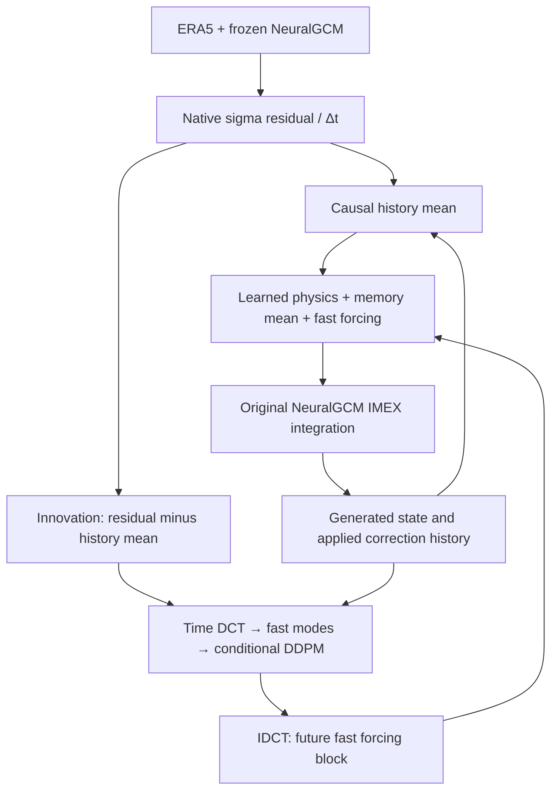

# NeuralGCM + time-DCT diffusion + finite-history closure

NeuralGCM 잔차에서 단주기 변동을 학습하고, **과거 상태와 과거 보정항을 기억하는 네트워크**를 통해 learned physics 내부에 적용하는 연구용 구현입니다. 실제 NeuralGCM 적분기를 사용합니다. **실제 ERA5 학습에 따른40일 예측 개선·단기 성능 보존은 아직 검증하지 않았습니다.**

## Structure



The first forecast interval is pure NeuralGCM. Later noise blocks are generated once and held fixed through physical solver stages. No future observed residual is read during forecasting. SST/sea ice persist from issue time, with their timestamps advanced consistently. Matched baseline and candidate ensembles use identical initial conditions, native random keys, and boundary conventions.

| Requirement | Implementation |
|---|---|
| Gaussian-base diffusion | Conditional **DDPM**, cosine schedule; Gaussian corruption/prior, learned residual distribution; no flow matching |
| NeuralGCM residual | `(encoded ERA5 next − frozen NeuralGCM next) / Δt`, in SI per second |
| Time-axis DCT | Orthonormal DCT-II on genuine regular samples; frequency `k/(2NΔt)` |
| Short weather noise | Period≤48h for6h observations, DC excluded |
| Memory in learned physics | All-channel state and past-correction history conditions both networks; tendency added **before original IMEX integration** |
|40-day forecast |160 six-hour intervals, daily pressure-level outputs, streamed ensemble members |
|96GB / venv | Batched columns, memmaps, RAM preflight/RSS checks, optional kernel cgroup cap; pinned CPU environment |
| Baseline comparison | Matched ensemble RMSE/ACC/CRPS/spread, day1/3/5 regression gate, day10/20/30/40 summaries |

## Setup and software tests

Tested on Python 3.12 CPU; the supplied environment requires Python 3.12. Legacy NeuralGCM 1.1.2 and its numerical dependencies are pinned; arbitrary newer JAX versions are incompatible.

```bash
bash scripts/setup_venv.sh
source .venv/bin/activate
ngcm-mz smoke --output runs/software_smoke
pytest -q
RUN_NEURALGCM_INTEGRATION=1 pytest -q tests/test_neuralgcm_backend.py tests/test_workflow_backend.py
```

Integration tests use NeuralGCM's bundled mini checkpoint and sample ERA5 with the actual spectral core. Repeated demo observations test operation, **not forecast skill**. GPU execution is unverified; rerun integration tests after changing the JAX/CUDA stack for your hardware.

## One-command ERA5 experiment

Supply an official trusted checkpoint and actual ERA5 files, then edit `configs/experiment.example.json`. Paths and issue dates are placeholders. The default archive split is chronological70%/15%/15%; explicit interval-index bounds can be supplied in `prepare.splits`. Forecast history and its complete40-day horizon must fit in the declared validation/test period.

```bash
ngcm-mz-workflow run configs/experiment.example.json
```

This prepares sigma residuals, trains both networks, computes training-only pressure climatology, generates paired40-day ensembles, and writes evaluation JSON. Source files are read one timestamp at a time and optionally conservatively regridded using Dinosaur. Original ERA5 files are never moved or modified; existing run directories are refused.

For a **kernel-enforced96000000000-byte host-memory cap** on Linux with a user systemd/cgroup session:

```bash
scripts/run_96gb.sh .venv/bin/ngcm-mz-workflow run configs/experiment.example.json
```

This launcher does not silently substitute an advisory limit if systemd is unavailable. Use your scheduler/container's equivalent memory cgroup otherwise. Direct commands use preflight estimates and RSS checks, which cannot prevent every transient allocator spike. GPU VRAM is separate from host RAM.

## Individual stages

```bash
ngcm-mz-workflow prepare configs/prepare.example.json
ngcm-mz train --archive runs/era5_sigma_residuals --config configs/train_6hour.json --output runs/closure.npz
ngcm-mz-workflow forecast configs/forecast.example.json
ngcm-mz-workflow verify configs/verify.example.json
```

The standalone verification configuration requires a training-only pressure climatology `.npy`. The combined `run` command creates it. Alternatively `ngcm-mz-workflow climatology config.json` accepts preparation settings plus a `climatology` output path. Its annual mean is a simple baseline: use day-of-year/valid-time training climatology for seasonal ACC studies. The evaluator accepts `[channel,lat,lon]` or `[case,lead,channel,lat,lon]` climatology.

Forecast modes: `full`, `memory` (diffusion disabled), and `off` (exact base). `correction_scale=0` bypasses correction. The example0.1 is **uncalibrated**. Select strength using validation rollouts, then freeze it before held-out tests. The combined experiment defaults to no RMSE worsening at day1/3/5 (`short_tolerance=0`). This descriptive gate is not a statistical guarantee. Evaluate many initial dates and use scale0 if no candidate meets your short-term criterion.

## Data contract

- Local ERA5 NetCDF glob or Zarr. Timestamps must be genuinely regular; no interpolated observations are manufactured for DCT.
- Required atmospheric variables and pressure levels come from the checkpoint. Short names `t,q,z,u,v,clwc,ciwc,sst,ci/siconc` are mapped to official names. Pressure must be in hPa. Missing levels/variables fail explicitly; vertical interpolation is not implicit.
- SST and sea-ice fields normally required by official checkpoints must be supplied. They are not fabricated from unrelated surface variables.
- **Daily ERA5 cannot identify subdaily noise.** For daily data set preparation and training `dt_hours=24` and a resolvable cutoff such as `max_period_hours=96`. This models2–4day variability. The default6h configuration needs actual6h observations.
- Closure archives flatten variable×sigma into `[time,channel,lat,lon]`. Native NeuralGCM arrays are `[sigma,lon,lat]`. The adapter explicitly converts SI tendencies into nondimensional spectral quantities, including wind→vorticity/divergence and custom-coordinate interpolation.
- History states end at issue time; past residual intervals end immediately before it. Future residuals are training targets only. All windows stay inside declared splits; normalization uses training data only.
- Closure checkpoints use safe NPZ/JSON (`allow_pickle=False`). Original NeuralGCM checkpoint pickle files must be trusted. SHA256 binds the learned closure to its exact baseline checkpoint.
- Outputs include `baseline.npy`, `ensemble.npy` `[case,member,day,channel,lat,lon]`, coordinates and `forecast.json`; verification adds `truth.npy` and `evaluation.json`. General `ngcm-mz evaluate` supports multiple initial dates. A single date is not strong skill evidence.

## Scientific scope

This is a **finite-history MZ-inspired closure**, adapted from the lagged-history idea in `Hist_Bayesian_Closure`, not an exact orthogonal-dynamics solver or enforced fluctuation-dissipation identity. DDPM Gaussian corruption is distinct from physical white noise. Strict high-pass forcing has zero block mean and does not alone establish Hasselmann red-noise accumulation. A full-band learned history mean supplies possible slower response; prior stochastic corrections influence subsequent conditioning. Realistic low-frequency spectra still require measurement.

NeuralGCM parameters remain frozen. Training fits encoded interval-average tendency proxies offline, not end-to-end40-day rollout loss. Encoder/reconstruction and numerical errors are part of the target. A shared column MLP sees all variable/level history but lacks a horizontal joint noise covariance model. Full ArchesWeather and ClimateDiffuse spatial architectures are not embedded. Generated-history distribution shift, stability and physical budget drift require validation. A gain constant over each time block bounds amplitudes while preserving the fast component's spectral support; it is not a conservation constraint.

See [equations](docs/THEORY.md), [source provenance](docs/SOURCES.md), and [verification status](docs/VALIDATION.md). Supplied papers informed the theory; paper files and ERA5 data are not redistributed.
